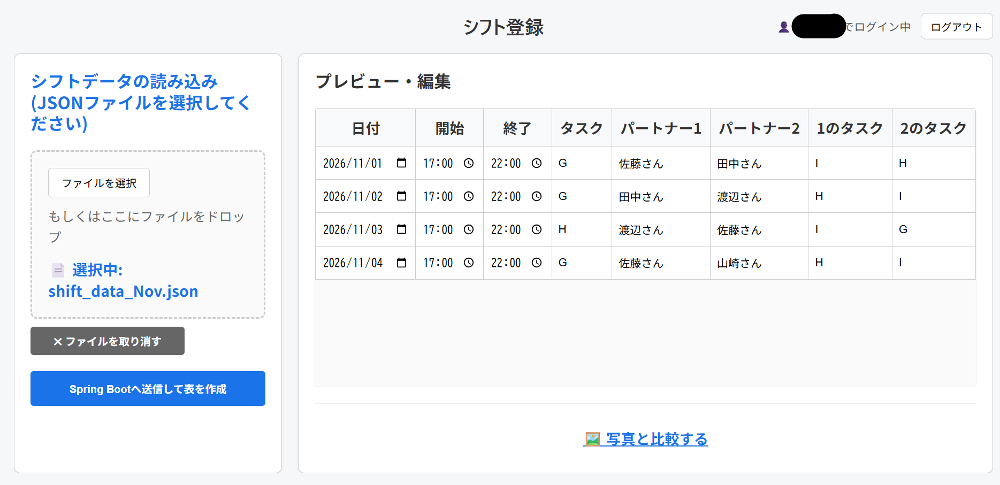
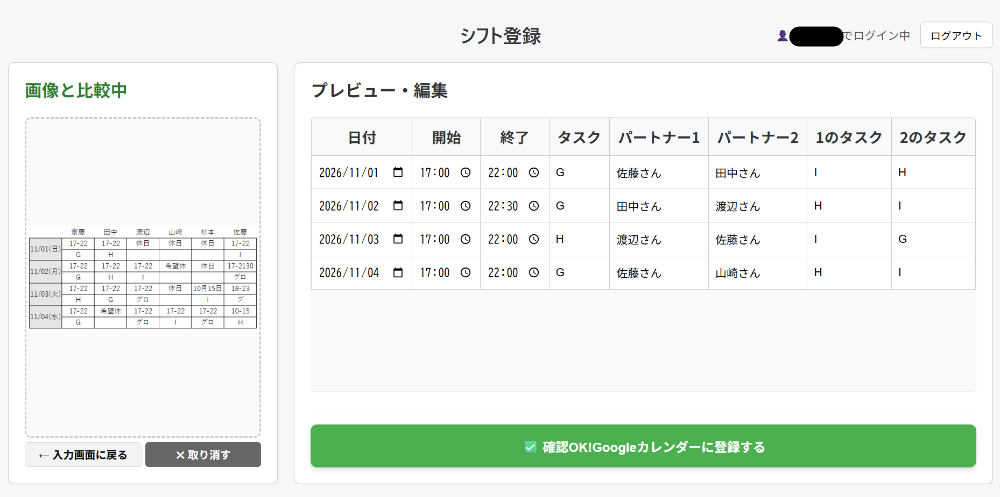

# バイトシフト管理アプリ（BaitoShiftApp）

紙で張り出されるアルバイトのシフトを読み込み、内容を確認・編集してGoogleカレンダーにまとめて登録できるWebアプリです。

## 🔗 アプリURL

https://baito-shift-app.vercel.app

※ 現在はフロントエンドのみ公開しています（バックエンドは未デプロイ）。ログイン後の画面は、下の画面イメージをご覧ください。
※ OAuth はテストモードのため、Googleログインは登録済みのユーザーのみ利用できます。

## 📷 画面イメージ

### シフト登録画面



左でシフトデータ（JSONファイル）を読み込むと、バックエンド（Spring Boot）で整形したデータが右側に表で表示されます。表の内容はその場で編集できます。

### 写真との比較画面



「写真と比較する」を押すと、紙のシフト表の写真を並べて表示できます。写真と登録内容を見比べながら修正し、確認が終わったら緑のボタンでGoogleカレンダーに登録します。

> ※ プライバシー保護のため、掲載している画像はすべて説明用に作成したサンプルです。
> シフト表は実際の形式を参考に自作したもので、記載されている名前はすべて架空の人物です。

## ✨ 主な機能

- Googleアカウントでのログイン
- JSONファイルからのシフトデータの読み込み
- シフトの仕事内容・時間・一緒に働く人の名前の確認と編集
- 紙のシフト表の写真との見比べ
- シフト情報の保存
- Googleカレンダーへの予定の登録

## 💡 開発の背景

アルバイト先のシフトが紙で張り出されるため、毎回カレンダーに手入力する必要があり、時間がかかるうえに入力ミスも起きていました。この手間とミスを減らすために開発しました。

## 🛠 使用技術

| 区分 | 技術 |
| --- | --- |
| フロントエンド | React / TypeScript / Vite |
| バックエンド | Java / Spring Boot |
| データベース | MySQL |
| 外部API | Google Calendar API（OAuth 2.0） |
| デプロイ | Vercel（フロントエンドのみ。バックエンドは未デプロイ） |

## 🔥 工夫した点・苦労した点

- **Googleカレンダー連携をバックエンドで処理**
  認証情報をブラウザ側に置かず安全に扱うため、ログインやカレンダー登録の処理をバックエンドに移しました。
- **確認しやすい登録画面**
  画面を左右に分け、左でJSONファイルを選ぶと、バックエンドで整形したデータが右に表で表示されるようにしました。さらに「写真と比較する」を押すと、左側に紙のシフト表の写真をドロップでき、写真と見比べてから登録できます。カレンダーに登録する前に、人の目で最終確認できる設計にしました。
- **初めてのTypeScriptでの開発**
  TypeScriptは初めてだったため、生成AI（Claude）に相談しながら進めました。その中で、TypeScriptの型の書き方や `async` / `await` による非同期処理を理解できるようになりました。

## 🚀 ローカルでの環境構築

### 使用したバージョン

| 名前 | バージョン |
| --- | --- |
| Node.js | 22.20.0 |
| Java | 25 |
| MySQL | 9.4.0 |

### 手順

```bash
# リポジトリのクローン
git clone https://github.com/Tadahiro10/BaitoShiftApp.git
cd BaitoShiftApp

# バックエンドの起動（MySQLを起動しておく）
cd 〇〇
./mvnw spring-boot:run

# フロントエンドの起動（別のターミナルで）
cd shift-management-frontend
npm install
npm run dev
```

### 環境変数・設定

- Google Cloud Console で Google Calendar API を有効にし、OAuth クライアントID を作成
- 同じ画面の「承認済みの JavaScript 生成元」に `http://localhost:5173` を追加
- フロントエンド：`shift-management-frontend/.env` に以下を設定
  ```
  VITE_GOOGLE_CLIENT_ID=あなたのOAuthクライアントID
  ```
- バックエンド：`application.properties` にMySQLの接続情報とGoogleの認証情報を設定
